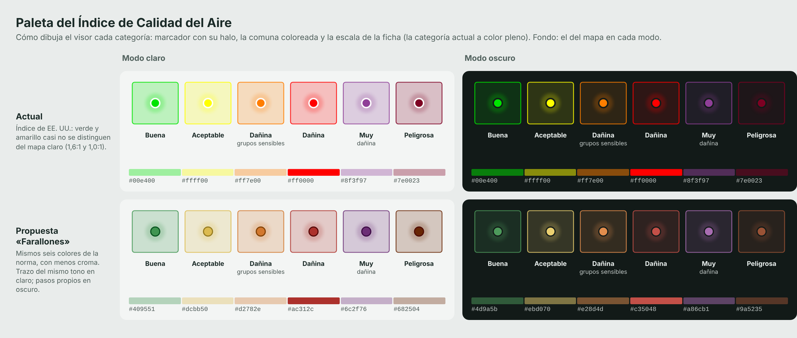
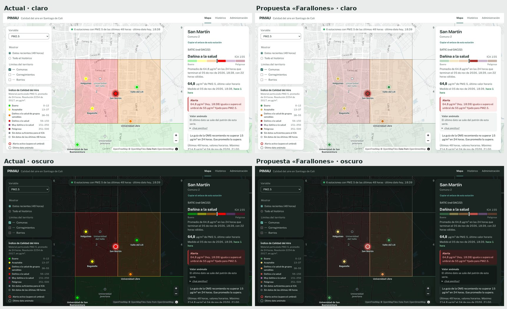

# Plan de mejora de PIMAU: toda la aplicación

6 de noviembre de 2026 · rama `claude/plan-mejora-interfaz-khegj8`

El [plan de la interfaz](plan_mejora_interfaz.md) ya se ejecutó. Este va más
allá del visor: fuentes de datos, backend, analítica, operación en Azure,
seguridad, pruebas, documentación y una paleta nueva para el ICA. Parte de la
revisión del 5 y el 6 de noviembre, de lo que John agregó en `main`
(despliegue en Azure con HTTPS y reinicio automático) y de una prueba de las
fuentes hecha hoy desde la nube.

## Cómo leer este plan

Cada tarea dice **qué** hacer, **por qué** (con la evidencia), **cómo**, **cuándo
está lista** y un esfuerzo estimado:

- **S**: hasta un día. **M**: de dos a cuatro días. **L**: una semana o más.
- **P0**: sin esto la plataforma no cumple su propósito o corre un riesgo serio.
  **P1**: mejora importante. **P2**: deseable.

Las tareas llevan un código (A1, B2…) para citarlas en commits y en la bitácora.

---

## 1. Dónde estamos

### 1.1 Fuentes de datos (probadas hoy, 6 de noviembre)

Se probaron desde un entorno en la nube que permite los portales de las fuentes.

| Fuente | Respuesta hoy | Qué significa |
| --- | --- | --- |
| SATIC (red OAC22) | 200: el geoportal real, sin el comunicado de suspensión | Volvió (la bitácora del 4 de noviembre lo confirma desde Colombia). **Desde el servidor de Azure responde 403**: en producción los datos recientes llegan hasta el 4 de noviembre. La descarga completa con el navegador no se probó desde aquí: acepta los términos del portal de forma automática, justo lo que A2 busca formalizar. |
| Datos Abiertos de Cali (CKAN) | 403 con el comunicado del 21 de octubre | Sigue suspendido. No afecta los datos: su histórico ya está cargado y no publica nada nuevo desde 2020. |
| IDEAM (datos.gov.co) | 200 | El último registro es del 1 de enero de 2026. Para Cali, 2025 solo trae **Cascajal (CVC), 58 503 registros**; las estaciones del DAGMA ya no aparecen en ese conjunto. |
| IDESC (WFS) | 200 | Comunas, barrios y corregimientos disponibles. |
| OpenAQ | Sin probar | Sigue sin clave de API (pendiente desde el 9 de octubre). |
| OpenFreeMap (mapa base) | 200 | Normal. |

### 1.2 Lo que ya quedó resuelto

- **Producción:** https://pimau-cali.chilecentral.cloudapp.azure.com en Azure for
  Students (2 vCPU, 4 GB, 64 GB de disco), HTTPS de Let's Encrypt con Caddy, la
  IP real del cliente detrás de Caddy y nginx, y todos los servicios con
  `restart: unless-stopped` (`docker-compose.produccion.yml`).
- **Datos tardíos de SATIC:** un valor que llega después reemplaza al faltante
  implícito (98b9c13), con prueba.
- **Interfaz:** las siete fases del plan anterior, con 70 pruebas de extremo a
  extremo y de accesibilidad en CI.
- **Hoy:** el CSS de MapLibre, que llega en diferido con el mapa, seguía pisando
  la posición de los botones de zoom y los colores de la atribución en modo
  oscuro. Quedó arreglado y con una prueba que lo vigila (51d679f). El alto del
  mapa ya lo había arreglado John (d988445).

### 1.3 Rendimiento: las cifras corregidas

La medición de la fase 6 del plan anterior (rendimiento 86) se tomó con el mapa
en 0 px de alto, así que MapLibre casi no trabajaba. Las de abajo están hechas
en las mismas condiciones para los tres builds: Lighthouse 13.5, perfil móvil,
mediana de tres corridas, API simulada y **mapa base dibujado**.

| Build | Rendimiento | FCP | LCP | TBT | CLS |
| --- | --- | --- | --- | --- | --- |
| Antes del plan de la interfaz | 32 | 3,8 s | 4,2 s | 4,3 s | 0,31 |
| Hoy, con el mapa cargado de entrada | 50 | 3,2 s | 3,7 s | 4,5 s | 0,10 |
| **Hoy, con el mapa diferido (lo que quedó)** | **54** | **2,5 s** | **3,6 s** | 4,5 s | **0,10** |

El TBT de 4,5 s es MapLibre dibujando con WebGL por software: el contenedor de
medición no tiene GPU y Lighthouse frena la CPU 4 veces. En un celular real,
con GPU, ese número debería ser mucho menor. Hay que medirlo en un equipo real
antes de sacar conclusiones (tarea D6).

---

## 2. Tareas por frente

### A. Datos y fuentes

El punto débil de la plataforma no es el código: es tener datos recientes
estables. Por eso este frente va primero.

#### A1 · SATIC en producción, a pesar del bloqueo a Azure (P0, M)

- **Por qué:** SATIC responde 403 a la IP del servidor y 200 desde Colombia. Es
  la única fuente con datos del día; sin ella el mapa en «Datos recientes»
  queda vacío y no hay alertas.
- **Cómo (dos caminos, en paralelo):**
  1. **El camino de fondo: pedir acceso formal** (ver A2). Lo ideal es que la
     Alcaldía permita la IP de Azure o dé acceso a su API interna
     (`satic.cali.gov.co:9090/api`).
  2. **Puente mientras tanto, desde Colombia.** Un equipo en Cali (de la
     Universidad de San Buenaventura, que aloja una estación de la red, o el de
     un integrante del proyecto) corre el contenedor `descarga-satic` cada hora
     y sube los Excel al servidor:
     - Opción simple: `rsync` por SSH con una llave limitada a la carpeta
       `data/satic` (con `command=` en `authorized_keys`).
     - Opción integrada: una ruta `POST /api/admin/satic/archivos` con el token
       del administrador, que valide nombre, tamaño (por ejemplo, 5 MB máximo)
       y tipo de archivo, guarde en la bandeja y deje constancia en la
       auditoría. El panel puede tener un botón para subir a mano (E2).
- **Listo cuando:** en producción entran datos de SATIC de las últimas 3 horas
  durante 7 días seguidos, y el panel muestra la hora de la última subida.
- **Depende de:** A2 para el camino de fondo; nada para el puente.

#### A2 · Formalizar el uso de SATIC (P0, S de trabajo, plazo externo)

- **Por qué:** el 9 de octubre se decidió esperar autorización. El 21 se empezó
  a descargar cada hora con un navegador que acepta los términos por su cuenta,
  y ahora el portal bloquea al servidor. La solicitud ya está redactada
  (`docs/gestion/solicitud_acceso_datos_satic.md`).
- **Cómo:** enviar la solicitud con el director y pedir tres cosas concretas:
  permiso de uso con fines académicos, la frecuencia aceptable (una vez por
  hora o menos) y acceso desde la IP de Azure o a la API. Mientras tanto,
  identificar el descargador (un `User-Agent` con el nombre del proyecto y un
  correo institucional) y no bajar de 60 minutos entre corridas.
- **Listo cuando:** hay una respuesta escrita, registrada en la bitácora y
  citada en el documento del trabajo de grado.

#### A3 · Cargar el 2025 de Cascajal desde el IDEAM (P1, S)

- **Por qué:** el IDEAM ya publica 2025 para Cascajal (58 503 registros) y la
  plataforma lo tenía hasta el 1 de enero de 2025.
- **Cómo:** en el panel, revisar la última ejecución del IDEAM. Si no trajo
  2025, correr `docker compose run --rm ingesta python -m pimau.ingesta
  ejecutar --fuente ideam` y verificar con `estado`.
- **Listo cuando:** el Histórico muestra 2025 en Cascajal y la bitácora
  registra cuántas mediciones entraron.

#### A4 · Portal de Datos Abiertos de Cali (P2, S)

- **Por qué:** sigue suspendido, pero su histórico (2010 a 2020) ya está cargado.
- **Cómo:** bajar la frecuencia de la fuente en el panel a una vez por semana,
  para no llenar el registro de errores. En el visor, describirla como fuente
  histórica (ver D2).
- **Listo cuando:** el panel deja de mostrar un error diario de esta fuente.

#### A5 · OpenAQ (P1, S)

- **Por qué:** la clave está pendiente desde el 9 de octubre, y OpenAQ podría
  traer sensores de Cali que no están en SATIC.
- **Cómo:** crear la clave gratuita, guardarla solo en el `.env` del servidor
  (`OPENAQ_API_KEY`) y revisar qué ubicaciones de Cali tiene antes de escribir
  el conector. Si no hay datos recientes de Cali, registrarlo y descartar la
  fuente.
- **Listo cuando:** hay una decisión con evidencia en la bitácora.

#### A6 · Buscar fuentes oficiales nuevas (P1, plazo externo)

- **Por qué:** con el IDEAM sin estaciones del DAGMA en 2025 y el portal de
  Cali suspendido, la ciudad no tiene una fuente oficial reciente aparte de
  SATIC.
- **Cómo:** escribir al DAGMA (red de monitoreo de calidad del aire de Cali) y
  a la CVC (Cascajal, Jamundí) preguntando si publican datos recientes, por
  qué medio y con qué licencia. Solo fuentes abiertas u oficiales: nada que
  exija saltarse términos de uso.
- **Listo cuando:** cada contacto queda en la bitácora con su respuesta.

#### A7 · Guardar en la base qué estaciones son la misma (P1, M)

- **Por qué:** hoy el visor agrupa las estaciones de dos fuentes comparando sus
  nombres (`claveEstacion`). Funciona, pero es frágil y está pendiente desde el
  incremento 2.
- **Cómo:** tabla `sitio` (nombre, coordenadas oficiales, comuna) y columna
  `estacion.sitio_id`, llenada por una migración con los grupos que hoy arma el
  visor. La API devuelve `sitio_id` y el visor agrupa por él.
- **Listo cuando:** el visor ya no compara nombres y las pruebas cubren Era
  Obrero y Base Aérea, que llegan con códigos distintos de dos fuentes.

#### A8 · Vigilar la frescura de cada fuente (P1, M)

- **Por qué:** una fuente puede seguir «correcta» pero sin datos nuevos. Pasó con
  SATIC: el descargador fallaba y la ingesta seguía leyendo archivos viejos.
- **Cómo:** para cada fuente activa, una edad máxima esperada (SATIC 3 horas,
  IDEAM 45 días). Una ruta pública `GET /api/fuentes/estado` devuelve, por
  fuente, la fecha del último dato y si está al día. El panel la muestra en
  rojo cuando se pasa, y el visor la usa en D2.
- **Listo cuando:** si SATIC lleva más de 3 horas sin datos, el panel y el visor
  lo dicen, con prueba de la API.

### B. Backend y API

#### B1 · Calcular el ICA de cada serie de forma incremental (P1, M)

- **Por qué:** cada 9 minutos `/api/estaciones` recalcula los promedios móviles
  de 24 horas sobre todas las mediciones válidas (`consultas.estaciones`). El
  servidor tiene 6,19 millones de mediciones y 2 vCPU, y la cifra crece cada hora.
- **Cómo:** tabla `estado_serie` (estación, parámetro, último valor válido,
  último ICA representativo con su promedio, horas válidas y fecha, última
  marca, anomalías de 48 horas). La ingesta la actualiza solo para las series
  que recibieron datos, calculando la ventana de las últimas 24 horas de esa
  serie. La API lee la tabla. Una migración la llena una vez con la consulta
  actual.
- **Listo cuando:** `/api/estaciones` responde igual que hoy (prueba que compara
  ambos resultados sobre la base de pruebas) y su cálculo baja de segundos a
  milisegundos. Medir antes y después en el servidor.

#### B2 · Salud real del servicio (P1, S)

- **Por qué:** `/api/salud` siempre dice «ok», aunque la base no responda.
- **Cómo:** que consulte la base (`SELECT 1`) y devuelva la edad del último
  cálculo de indicadores. Agregar `healthcheck` a `api` y `web` en Docker
  Compose, para que `restart` actúe cuando un servicio se cuelga.
- **Listo cuando:** si se detiene la base, `/api/salud` responde 503 y
  `docker compose ps` lo muestra.

#### B3 · Memoria y auditoría bajo ataque (P1, S)

- **Por qué:**
  - El límite de solicitudes guarda una cola por IP y nunca borra las vacías, así
    que la memoria crece con cada IP distinta.
  - Cada intento sin token escribe una fila en la auditoría (con 120 solicitudes
    por minuto, unas 170 000 filas al día por IP).
- **Cómo:**
  - Borrar las colas vacías y poner un tope de IPs guardadas.
  - Agrupar los rechazos repetidos: una fila por IP y por minuto, con el número
    de intentos.
- **Listo cuando:** hay una prueba que envía 1 000 solicitudes sin token y
  verifica a lo sumo una fila por minuto.

#### B4 · Imagen del backend para producción (P2, S)

- **Por qué:** la imagen instala `requirements-dev.txt` (pytest, ruff,
  pip-audit) y corre como root.
- **Cómo:** separar la etapa de pruebas de la de producción (Docker multietapa) y
  crear un usuario sin privilegios.
- **Listo cuando:** la imagen de producción no trae pytest, corre como usuario
  normal y CI sigue verde.

#### B5 · CSV que Excel abra bien (P2, S)

- **Por qué:** el CSV sale en UTF-8 sin marca BOM, y Excel en Windows muestra
  mal las tildes («Cañaveralejo»).
- **Cómo:** anteponer la marca BOM (`U+FEFF`). Opcionalmente, un parámetro
  `separador=punto_y_coma` para el Excel en español.
- **Listo cuando:** el archivo abre con tildes en Excel y la prueba de la API
  verifica la marca.

### C. Analítica

#### C1 · Pronóstico (RF-12) (P1, L)

- **Por qué:** es el requisito que falta del incremento 4.
- **Cuándo:** solo cuando A1 dé datos recientes estables durante al menos 4
  semanas. Si eso no ocurre antes de una fecha que fije el director, acotar el
  requisito por escrito.
- **Cómo:**
  1. Línea base: persistencia (mañana igual que hoy a la misma hora) y
     climatología horaria por estación.
  2. Modelo: gradient boosting por estación, con rezagos de PM2.5, hora, día de
     la semana y meteorología de SATIC (temperatura, humedad, viento).
  3. Evaluación: error absoluto medio de 1 a 24 horas de horizonte, y mejora
     frente a la persistencia. Validación por bloques de tiempo, nunca al azar.
  4. Visor: el pronóstico con su incertidumbre (banda del percentil 10 al 90) y
     una nota de que es un modelo. Las alertas sobre pronósticos (RF-14) solo
     si superan a la persistencia.
- **Listo cuando:** el modelo supera a la persistencia en al menos 15 % a 6
  horas, en validación, y la bitácora registra las cifras.

#### C2 · Validar las anomalías con eventos reales (P1, M)

- **Por qué:** el umbral (0,62) se calibró con anomalías sintéticas. En las series
  reales marca entre el 1 y el 3 % de las horas, y no se sabe cuántas son
  falsas alarmas.
- **Cómo:** armar una lista de eventos conocidos (la pólvora del 31 de diciembre
  de cada año, quemas reportadas, días sin carro) y medir cuántos detecta.
  Agregar al panel una forma de marcar una anomalía como «falsa alarma» o
  «evento real», y usar esas marcas para recalibrar.
- **Listo cuando:** hay precisión y exhaustividad medidas con eventos reales,
  registradas en la bitácora.

#### C3 · Limpieza de modelos guardados (P2, S)

- **Cómo:** conservar los 3 últimos modelos por serie en `./modelos` y borrar el
  resto en cada ciclo.

### D. Visor y experiencia

#### D1 · Paleta nueva del ICA «Farallones» (P1, M)

Está detallada en la sección 3.

#### D2 · Mostrar en el visor el estado de las fuentes (P1, S)

- **Por qué:** hoy, si SATIC no trae datos, el mapa dice «Ninguna estación tiene
  PM2.5 de las últimas 48 horas» sin explicar por qué.
- **Cómo:** con A8, un aviso breve: «SATIC no envía datos desde el 4 de
  noviembre. Los datos recientes se reanudan cuando vuelva.» En la lista de
  fuentes del pie, cada fuente con su estado (al día, con retraso, histórica).
- **Listo cuando:** la prueba de extremo a extremo cubre una fuente atrasada.

#### D3 · Prueba con usuarios y celulares reales (P1, M)

- **Cómo:** con el guion de [guion_prueba_usuarios.md](guion_prueba_usuarios.md),
  y repitiendo las tareas con la paleta nueva.
- **Listo cuando:** los hallazgos con evidencia están en la bitácora.

#### D4 · Decidir la ficha del celular (P2, M)

- **Cómo:** con los resultados de D3, decidir si la ficha pasa a una hoja
  inferior sobre el mapa o se queda como está.

#### D5 · Saltos de diseño que quedan (P2, S)

- **Por qué:** Lighthouse marca dos desplazamientos que ya existían antes del
  plan: los botones de zoom (0,069) y la ficha cuando aparece el estado de los
  datos arriba (0,031).
- **Cómo:** fijar la posición de los controles del mapa desde el primer pintado y
  reservar el alto del estado del panel.
- **Listo cuando:** CLS por debajo de 0,05 en la mediana de tres corridas.

#### D6 · Medir el mapa en un celular real (P1, S)

- **Por qué:** el TBT de 4,5 s se midió sin GPU.
- **Cómo:** abrir el sitio de producción en un Android de gama media con las
  herramientas de Chrome conectadas por USB, o usar PageSpeed Insights sobre la
  URL pública (el plugin Perf Profiler lo hace con
  `perf_report.py --psi`). Si el bloqueo sigue alto: encuadre con `maxZoom` 13,
  `fadeDuration: 0`, `renderWorldCopies: false` y las capas de barrios solo al
  activarlas.
- **Listo cuando:** hay cifras de un equipo real en la bitácora.

#### D7 · «¿Qué significa?» para cada categoría (P2, S)

- **Por qué:** la ficha dice la categoría, pero no qué hacer.
- **Cómo:** solo con texto de una fuente oficial citada (las recomendaciones que
  acompañan el ICA en las publicaciones del Ministerio de Ambiente o del IDEAM).
  Sin fuente verificable, no se agrega.

#### D8 · La leyenda no debe recibir foco si no se desplaza (P2, S)

- **Cómo:** un `ResizeObserver` que ponga `tabIndex` solo cuando la leyenda tiene
  más contenido que alto. Quedó pendiente de la revisión de código.

### E. Administración

| Código | Tarea | Prioridad · esfuerzo |
| --- | --- | --- |
| E1 | Botón «Ejecutar ahora» por fuente, auditado | P2 · S |
| E2 | Subir archivos de SATIC desde el panel (parte de A1) | P1 · S |
| E3 | Cambiar la contraseña desde el panel y ver los administradores | P2 · S |
| E4 | Descargar el registro de auditoría en CSV | P2 · S |
| E5 | Tarjeta de frescura por fuente (parte de A8) | P1 · S |

### F. Seguridad

#### F1 · Cabeceras de seguridad (P1, S)

- **Cómo:** en el `Caddyfile` o en nginx, agregar:
  - `Strict-Transport-Security` de un año;
  - `Content-Security-Policy` con `default-src 'self'`, `connect-src 'self'
    https://tiles.openfreemap.org`, `img-src 'self' data: blob:
    https://tiles.openfreemap.org`, `worker-src 'self' blob:` y
    `frame-ancestors 'none'`;
  - `X-Content-Type-Options: nosniff` y `Referrer-Policy: same-origin`.

  Probar que el mapa y las gráficas siguen funcionando con la política activa.
- **Listo cuando:** securityheaders.com da A o más y las pruebas siguen verdes.

#### F2 · Dependencias al día (P1, S)

- **Por qué:** `npm audit` marca 7 avisos moderados en eslint y vitest, solo de
  desarrollo. La imagen del descargador usa Playwright 1.48, de 2024.
- **Cómo:** actualizar vitest y eslint, subir la imagen de Playwright y activar
  Dependabot para npm, pip y Docker.

#### F3 · Secretos y registros (P2, S)

- **Cómo:** documentar cómo rotar `JWT_SECRETO` y la clave de la base, dejar el
  `.env` del servidor con permisos `600` y verificar que ningún registro
  imprima tokens ni contraseñas.

### G. Operación y costos

#### G1 · El crédito de Azure (P0, S para decidir)

- **Por qué:** la bitácora estima unos USD 47 al mes. El crédito de Azure for
  Students suele ser de unos USD 100 por año (**hay que verificar el saldo
  real**), así que alcanzaría para pocos meses. Si se acaba, el servidor se
  apaga.
- **Cómo:** revisar el saldo y la fecha estimada de agotamiento en el portal de
  Azure. Comparar tres opciones:
  1. una máquina más pequeña después de B1;
  2. un servidor de la universidad, que además resolvería el bloqueo de SATIC
     si está en Colombia;
  3. apagar en las fechas en que no se necesite la demostración.

  Poner una alerta de presupuesto en Azure.
- **Listo cuando:** hay una decisión con fecha en la bitácora y una alerta de
  costo configurada.

#### G2 · Respaldos fuera del servidor (P0, S)

- **Por qué:** los volcados diarios quedan en el mismo disco. Si se pierde la
  máquina, se pierde todo.
- **Cómo:** copiar el volcado de cada día a otro lugar: un contenedor de Azure
  Blob con política de retención, o una copia semanal descargada a un equipo de
  la universidad. Una vez al mes, restaurar un volcado en una base de prueba y
  anotar el resultado.
- **Listo cuando:** existe una copia fuera del servidor con menos de 24 horas y
  una restauración probada en la bitácora.

#### G3 · Monitoreo y alertas (P1, S)

- **Cómo:** un servicio gratuito de monitoreo de disponibilidad (por ejemplo,
  Healthchecks.io o UptimeRobot) que consulte `/api/salud` (B2) cada 5 minutos y
  avise por correo. La ingesta y la analítica avisan al terminar cada ciclo
  (un `ping`), así que también se nota si dejan de correr.

#### G4 · Que los registros no llenen el disco (P1, S)

- **Por qué:** Docker guarda los registros de cada contenedor sin límite por
  defecto, y el disco es de 64 GB.
- **Cómo:** en `docker-compose.produccion.yml`, `logging: driver: json-file` con
  `max-size: 10m` y `max-file: 3` para cada servicio.

#### G5 · Manual de operación (P1, S)

- **Cómo:** un `docs/operacion.md` con desplegar, actualizar, restaurar un
  respaldo, rotar secretos, revisar el certificado y qué hacer si una fuente
  falla.

### H. Calidad y pruebas

| Código | Tarea | Por qué | Prioridad · esfuerzo |
| --- | --- | --- | --- |
| H1 | Validar los datos simulados de las pruebas contra el esquema OpenAPI de la API | Si la API cambia, las pruebas del visor deben fallar en vez de seguir pasando con datos viejos | P1 · S |
| H2 | Comparación visual de capturas (Playwright `toHaveScreenshot`, con el mapa enmascarado) | Que un cambio de CSS no rompa una vista sin que nadie lo vea; hoy pasó con el mapa | P1 · M |
| H3 | Prueba de rendimiento de `/api/estaciones` con un volcado real | Verificar B1 con números | P1 · S |
| H4 | Un servicio de Docker Compose para correr las pruebas de integración en local | Hoy 24 pruebas solo corren en CI | P2 · S |

### I. Documentación y trabajo de grado

| Código | Tarea | Prioridad · esfuerzo |
| --- | --- | --- |
| I1 | README: tabla de fuentes al día (SATIC activa pero bloqueada desde Azure, Cali suspendido, IDEAM hasta 2025), dirección de producción y enlace al manual de operación | P0 · S |
| I2 | Corregir las cifras de Lighthouse en el plan de la interfaz y la bitácora (hecho hoy) | Hecho |
| I3 | ADR para la carga diferida, la paleta y el puente de SATIC | P1 · S |
| I4 | Llevar al Capítulo 3 y 4 las tablas de la bitácora y los resultados de D3 | P1 · M |

---

## 3. Paleta de colores del ICA

### 3.1 El problema

La Resolución 2254 de 2017 nombra los seis colores (verde, amarillo, naranja,
rojo, púrpura y marrón), pero **no fija códigos** (bitácora, 2026-10-09). Los
que usa la plataforma son los del índice de Estados Unidos, y de ahí sale el
verde fosforescente. Además, sobre el fondo claro del mapa:

| Color actual | Contraste con el mapa claro | WCAG 1.4.11 pide |
| --- | --- | --- |
| Verde `#00E400` | 1,59:1 | 3:1 |
| Amarillo `#FFFF00` | 1,02:1 | 3:1 |
| Naranja `#FF7E00` | 2,33:1 | 3:1 |

Es decir: un marcador amarillo casi no se distingue del mapa, y el borde blanco
que lo rodea tampoco (sobre un fondo casi blanco).

### 3.2 Principios de la propuesta

1. **Los mismos seis colores de la norma**, en el mismo orden.
2. **Menos croma**: tonos más naturales, en la línea de los grises verdosos de
   los Farallones que ya usa la interfaz. El color sigue marcando el estado sin
   gritar.
3. **La luminosidad acompaña la gravedad**: del amarillo (el más claro) al
   marrón (el más oscuro). Así cada categoría se separa de su vecina también
   por claridad, no solo por tono.
4. **Un juego para cada modo**: en oscuro, los tonos suben de luminosidad para
   tener contraste con el mapa oscuro.
5. **Un trazo del mismo tono, más oscuro**, para los marcadores en modo claro. El
   borde da el contraste de 3:1 aunque el relleno sea claro (el amarillo nunca
   llega a 3:1 sin dejar de verse amarillo).
6. **La categoría siempre con su nombre**, como hoy. El color nunca va solo.

### 3.3 Valores

| Categoría | Claro: relleno | Claro: trazo | Oscuro: relleno | OKLCH claro (L, C, h) |
| --- | --- | --- | --- | --- |
| Buena (verde) | `#409551` | `#0a5722` | `#4d9a5b` | 0,60 · 0,13 · 148 |
| Aceptable (amarillo) | `#dcbb50` | `#987e23` | `#ebd070` | 0,80 · 0,13 · 92 |
| Dañina para grupos sensibles (naranja) | `#d2782e` | `#854406` | `#e28d4d` | 0,66 · 0,14 · 56 |
| Dañina a la salud (rojo) | `#ac312c` | `#590b0b` | `#c35048` | 0,50 · 0,16 · 27 |
| Muy dañina a la salud (púrpura) | `#6c2f76` | `#400e48` | `#a86cb1` | 0,42 · 0,13 · 322 |
| Peligrosa (marrón) | `#682504` | `#500d00` | `#9a5235` | 0,36 · 0,10 · 42 |
| Sin datos suficientes (gris, sin cambio) | `#7d8790` | — | `#7f8a93` | — |

En el visor real (la propuesta todavía sin el trazo por categoría, que es parte
de la implementación):

### 3.4 Validación

Con el validador de la skill `dataviz` y con un cálculo propio en OKLab, que
pasará a ser la prueba unitaria del paso 6 de la sección 3.5:

| Prueba | Claro (mapa `#f3f5f4`) | Oscuro (mapa `#121a18`) |
| --- | --- | --- |
| Diferencia entre vecinos con visión normal (ΔE OKLab ×100, mínimo 15) | 16,3 a 23,5 | 15,2 a 26,4 |
| Diferencia entre vecinos con daltonismo (deuteranopia y protanopia, meta 8) | 13,8 o más | 13,8 o más |
| Croma mínimo (0,10, para no leerse gris) | Cumple | Cumple |
| Contraste del relleno con el mapa (3:1) | Verde 3,40, rojo 5,94, púrpura 8,32, marrón 10,34; naranja 2,97 y amarillo 1,70 llevan trazo | Los seis entre 3,06 y 11,62 |
| Contraste del trazo con el mapa claro | 3,59 a 13,95 | — |

Dos avisos del validador no aplican y quedan explicados:

- La **banda de luminosidad** es para paletas de categorías sin orden. El ICA es
  una escala de gravedad: que el amarillo sea el más claro y el marrón el más
  oscuro es parte del diseño.
- El **contraste del amarillo** con el fondo se resuelve con el trazo y con el
  nombre de la categoría, que siempre lo acompaña.

### 3.5 Cómo implementarla

1. **`web/src/colores.js`:** reemplazar `COLORES_ICA` por
   `PALETA_ICA = { claro: { relleno: [...], trazo: [...] }, oscuro: { relleno: [...] } }`,
   en el orden de las categorías. La API sigue mandando el nombre de la
   categoría; el visor elige el color según el modo.
2. **Mapa (`Mapa.jsx`):** cada estación lleva en sus propiedades el índice de la
   categoría (0 a 5). `circle-color` y `circle-stroke-color` salen de una
   expresión `match` sobre ese índice, con los valores de `TEMAS_MAPA`. En modo
   claro, trazo del mismo tono; en oscuro, el borde oscuro de hoy. El relleno de
   las comunas sube de 0,12 a 0,16 en modo oscuro (con tonos más suaves ya no
   se ve verde oliva) y se mantiene en 0,22 en claro.
3. **Ficha, leyenda y lista:** la escala, los puntos de la leyenda y los de la
   lista usan la misma paleta del modo activo.
4. **Base de datos:** una migración `0010` actualiza `umbral_referencia.color`
   con los rellenos del modo claro, para que la API, el CSV y cualquier otro
   consumidor vean los mismos colores.
5. **Otros colores que chocan:**
   - El punto verde de «datos de las últimas 48 horas» (`--vivo`) se confunde con
     «Buena»: pasa al acento de la interfaz.
   - El anillo de alerta (`#d03b3b`) queda cerca del rojo nuevo: pasa a un anillo
     punteado con el color de tinta y un ícono de alerta en la lista. La alerta
     se distingue por la forma, no solo por el color.
6. **Pruebas:**
   - Una prueba unitaria con la función de contraste que verifique los mínimos de
     la tabla 3.4, para que nadie cambie un color sin notarlo.
   - Las pruebas de extremo a extremo con los datos simulados en los colores
     nuevos.
   - Revisar a ojo las capturas del informe de CI.
7. **Documentación:** entrada en la bitácora con la tabla de valores y la
   lámina, y la decisión en un ADR (I3).

**Listo cuando:** el visor usa la paleta en los dos modos, las pruebas de
contraste pasan y la prueba con usuarios (D3) no encuentra confusiones entre
categorías vecinas.

---

## 4. Hoja de ruta

| Semana | Tareas | Resultado |
| --- | --- | --- |
| 1 | A1 (puente), A2, G1, G2, I1, A3 | Datos recientes en producción, costos bajo control, respaldo fuera del servidor y README al día |
| 2 | D1 (paleta), A8 + D2 + E5 (frescura), F1, G4, B2 | Paleta nueva, estado de las fuentes a la vista, cabeceras de seguridad |
| 3 | B1 + H3, B3, D3, D6, H1 | ICA incremental medido, prueba con usuarios y celular real |
| 4 | C2, H2, G3, G5, F2, A5, A6 | Anomalías validadas, comparación visual, monitoreo y manual |
| 5 en adelante | C1 (si A1 dio 4 semanas de datos), A7, D4, D5, D7, el resto de E y P2 | Pronóstico y pulido |

Dependencias que importan:

- C1 depende de A1: sin datos recientes estables no hay qué pronosticar.
- D2 depende de A8, y E2 es parte de A1.
- B1 conviene antes de achicar la máquina (G1).
- D3 conviene después de D1, para probar con la paleta nueva.

## 5. Riesgos

| Riesgo | Probabilidad | Impacto | Qué hacer |
| --- | --- | --- | --- |
| SATIC sigue bloqueando a Azure y no responde la solicitud | Alta | Alto: sin datos recientes | Puente desde Colombia (A1); servidor universitario (G1); fuentes oficiales nuevas (A6) |
| Se acaba el crédito de Azure | Media | Alto: la plataforma se apaga | Alerta de costo, máquina más pequeña, migrar (G1) |
| Se pierde el servidor | Baja | Muy alto | Respaldo fuera del servidor y restauración probada (G2) |
| SATIC cambia su página y el descargador deja de funcionar | Media | Medio | A8 lo detecta; la API oficial (A2) lo evita |
| La paleta nueva no se entiende igual que la conocida | Baja | Medio | Prueba con usuarios (D3); la categoría siempre va con su nombre |
| El pronóstico no supera a la persistencia | Media | Medio | Mostrarlo solo si la supera; acotar RF-12 con el director |

## 6. Cuándo una tarea está terminada

- Pruebas que la cubren, y todas las suites en verde (backend, unitarias del
  visor, extremo a extremo, presupuesto de carga).
- `code-review` sobre el diff antes de integrar.
- Una entrada en la bitácora con lo que se midió y lo que se decidió.
- El README o el manual de operación al día si cambia cómo se usa o se despliega.
